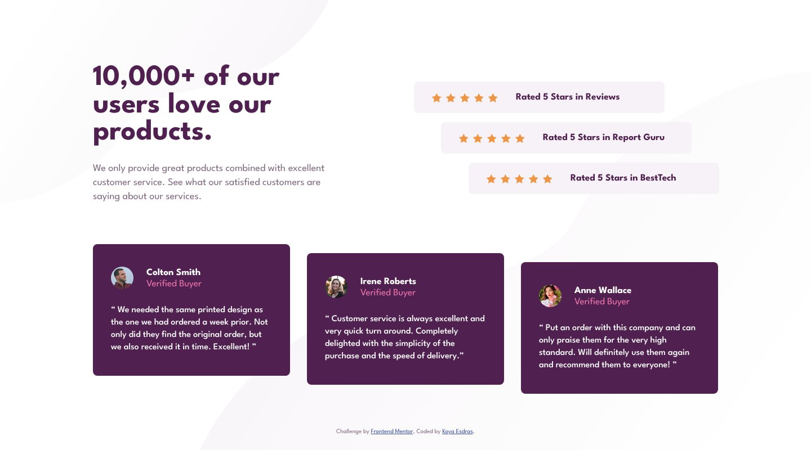

# Frontend Mentor - Social proof section solution

This is a solution to the [Social proof section challenge on Frontend Mentor](https://www.frontendmentor.io/challenges/social-proof-section-6e0qTv_bA). Frontend Mentor challenges help you improve your coding skills by building realistic projects.

## Table of contents

- [Overview](#overview)
  - [The challenge](#the-challenge)
  - [Screenshot](#screenshot)
  - [Links](#links)
- [My process](#my-process)
  - [Built with](#built-with)
  - [Workflow](#workflow)
  - [What I learned](#what-i-learned)
  - [Continued development](#continued-development)
  - [Useful resources](#useful-resources)
  - [AI Collaboration](#ai-collaboration)
- [Author](#author)

## Overview

### The challenge

Users should be able to:

- View the optimal layout for the section depending on their device's screen size

### Screenshot



### Links

- Solution URL: [frontendmentor.io/solutions/social-proof-section-tailwind-v4-staggered-layout-and-semantic-quotes-WV--E9iokR](https://www.frontendmentor.io/solutions/social-proof-section-tailwind-v4-staggered-layout-and-semantic-quotes-WV--E9iokR)
- Live Site URL: [ounokoya.github.io/social-proof-section](https://ounokoya.github.io/social-proof-section/)

## My process

### Built with

- Semantic HTML5: a list of ratings, a list of testimonials, each testimonial a `figure` with its `blockquote` and `figcaption`; decorative stars and photos with `alt=""`
- [Tailwind CSS v4](https://tailwindcss.com/) — design tokens in `@theme`, default palette removed
- League Spartan served with the site through [Fontsource](https://fontsource.org/fonts/league-spartan)
- Background patterns as CSS backgrounds, switched at 1024 px
- Mobile-first layout: a centred column (540 px max) below 1024 px, the staggered desktop layout from 1024 px
- [Vite](https://vite.dev/) for the build, deployed on GitHub Pages from the `gh-pages` branch (`npm run deploy`)
- [Playwright](https://playwright.dev/), [axe-core](https://github.com/dequelabs/axe-core), the W3C Nu validator, html-validate and ESLint for tests

### Workflow

Before any code, the design was analysed and rebuilt:

1. **Visual analysis in Excalidraw** — measurements in px, contrast checks of every text → [`specs/visuel/`](./specs/visuel/)
2. **Penpot mockup** — library, components, desktop, mobile and tablet screens, visual thresholds calibrated against the design JPGs → [`specs/visuel/penpot/`](./specs/visuel/penpot/)
3. **Spec, then tests** — 18 Given/When/Then scenarios and the accessible names the tests rely on → [`specs/specifications/`](./specs/specifications/); the tests were written before the code and checked to fail on the starter
4. **Decisions** — tokens, font loading, images and patterns, layout → [`specs/adr/`](./specs/adr/)
5. **Code** — one commit per part (structure, mobile, desktop, states), then a walk-through in a real browser → [`specs/analyse/`](./specs/analyse/)

### What I learned

**Staggered layouts without absolute positioning.** The ratings move 48 px to the right one after the other and the testimonials move down 16 px. Margins and offsets on otherwise normal flex and grid items keep the reading order and still shrink between 1024 and 1440 px:

```html
<li class="lg:w-[27.8125rem] lg:max-w-full lg:nth-2:ml-12 lg:nth-3:ml-[6.0625rem]">…</li>
```

**Text that wraps like the design.** The third line of the mobile paragraph measures 328 px in Chromium for a 327 px column, so it wrapped one word earlier. The fix is to widen the block by a pixel on each side, never to touch letter spacing. `text-rendering: geometricPrecision` also keeps glyph widths unrounded, so the lines break where the design breaks them.

**Contrast fixes that keep the look.** The paragraph colour (3.83:1) and "Verified Buyer" (4.30:1) were slightly too light: `hsl(303, 10%, 47%)` and `hsl(333, 80%, 70%)` reach 4.7:1 with nearly the same colours. The stars are decorative: the text says "Rated 5 Stars".

### Continued development

- **Visual comparison with the design files.** Screenshots differ from the Frontend Mentor JPGs by 3.3 % (desktop) and 5.5 % (mobile) of pixels; the mobile threshold is 7.3 %, because the thin League Spartan letters are drawn slightly differently from the JPG.
- In the design, "Rated 5 Stars in Reviews" (mobile) sits 4 px right of the centre; the page centres it like the other two.
- **Tablet**: my own proposal, the mobile column centred at 540 px.

### Useful resources

- [MDN — `<figure>` and `<figcaption>`](https://developer.mozilla.org/en-US/docs/Web/HTML/Element/figure) — marking up a testimonial.
- [MDN — `text-rendering`](https://developer.mozilla.org/en-US/docs/Web/CSS/text-rendering) — unrounded glyph widths.
- [Fontsource — League Spartan](https://fontsource.org/fonts/league-spartan) — self-hosted font files.

### AI Collaboration

I used **Claude (Claude Code)** as a pair, inside my own spec-driven workflow where I validated each step before the next one:

- **Planning**: Claude listed my unfinished challenges and my old solutions that needed work, and wrote the plan, which I validated.
- **Design analysis and mockup**: Claude measured the JPG designs, drew the annotated Excalidraw analysis and built the Penpot mockup; I reviewed both and decided on the contrast fixes, the tablet layout and the visual thresholds.
- **Spec and tests**: written by Claude before any code, from the validated mockup.
- **Technical decisions**: Claude presented the options; I chose to self-host the font with Fontsource, as in my previous challenge.
- **Code**: written by Claude from the spec — I confirmed this split at the code lock — one commit per part, with the tests run at each step.

What worked well: measuring the design's lines in the browser explained every wrap that differed. What needed my decisions: the colour fixes, the tablet layout and the thresholds.

## Author

- Frontend Mentor - [@ounokoya](https://www.frontendmentor.io/profile/ounokoya)
- GitHub - [@ounokoya](https://github.com/ounokoya)
